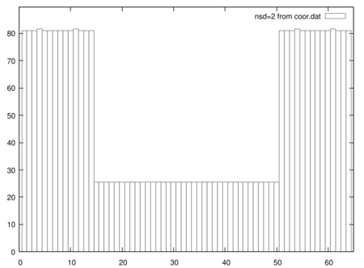
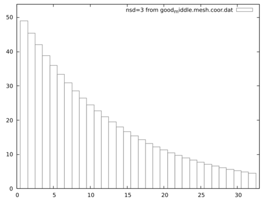
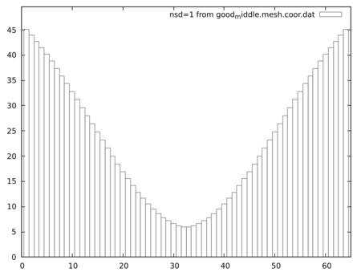

# mesh4CitcomS

## Intro

This program is designed to be used for creating a mesh file for a
[CitcomS](https://github.com/geodynamics/citcoms) model domain, a "coor.dat"
file as it is named in the documentation of CitcomS.

It makes easier to create meshes that have variable distances between adjacent
nodes, especially to make zones with more points per Km. This way you may
prepare the mesh for a *point of interest* (POI) of your choice.

For subduction  models for example, you may want to put a POI along your trench,
and towards the surface of the planet, so that the computations for this zone
of your model would be more accurate.

## Usage


### A bit of context

The "coor.dat" file contains the definition of the three "axis" portions that
form the computing domain of the model.

This program builds an object called "axis" that has functions to compute
the position of the mesh points along the specified segment of the  *O<sub>x</sub>* 
or *O<sub>y</sub>* or *O<sub>z</sub>* axis: the user  is required to build three
"axis" objects. Also functions to print the coordinates of the points and other info
are coded.

One "axis" object can be of one of three *types*:

* Regular: this makes the points on that axis regularly displaced with the
	same distance between them
* Linear: This makes the points on that axis spaced such as the distance between
	two adjacent nodes : N<sub>i</sub> and N<sub>i+1</sub> is a factor *f* bigger
	than the *previous* distance: that between the nodes N<sub>i-1</sub> and N<sub>i</sub>.
	In other words, if O<sub>x*i*</sub> is the coordinate of point N<sub>i</sub>,
	we can write:
			O<sub>x*i*</sub>-O<sub>x&nbsp;*(i-1)*</sub> = *f* x (O<sub>x *(i+1)* </sub>-O<sub>x*i*</sub> )
	Such distances are placed on a line with the slope *f*.
* Gaussian: Following the reasoning from the *_Linear_* type, here the slope *f* is replaced
	so the points on this type of axis are spaced in such way that the distances are placed
	on a Gauss curve.

### Illustrating Examples

If we want to *see* the variance of the distances between adjacent mesh nodes,
we may proceed to plot the distance from the *previous* node starting with the
second node and finishing with the last:

#### Regular
Plotting like this a *regular* axis would look like parts of the following image
(the middle part for example):




#### Linear
Plotting like this a *linear* axis would look something like the following image:




#### Gaussian
Plotting like this a *gaussian* axis would look like the following image:




### Actual usage

If you want to generate a parameterized grid with this tool,
import the ```mesh4CitcomS_2_1.py``` module in your Python script.

Look in ```mesh4CitcomS_utils.py``` for examples on how to:

* Instantiate an object: ``` xAxis = MakeAxis('gaussian',	'x', start_x, end_x, nodex)```
* Assign the properties used to place the POI:
	```code
		xAxis.fWhere=0.25
		xAxis.fWide=0.35
		xAxis.fSteep=0.05
	```
* Generate the coordinates on that axis: ``` xAxis.make_lSteps() ```
* Finally you can output to the console each axis, keeping the order needed to be
	compatible with CitcomS:
	```code
		xAxis.print_nodes()
		yAxis.print_nodes()
		zAxis.print_nodes()
	```
### Other operations

Looking into ```mesh4CitcomS_utils.py``` you may also find:

* A way to compute the _minimum_ and _maximum_ distance between adjacent nodes on an axis.

	```code
	xAxis.min_max_distance((end_x - start_x)*Earth_Radius_meters,  'Km')
	```
* A way to _mirror_ an axis.
	
	```code
	yAxisOther = mirror_me(yAxis)
	```
* A way to _cut_ a part from an axis.

	```code
	xAxisLow48 = getLow(0.48, xAxis)
	```
* A way to _over-write_ a part of an axis with a part from another one.

	```code
	updateLow(xAxisOther, xAxisLow48)
	```
* A way to remove unwanted space between adjacent nodes that
		appeared after the _cutting_ and/or _over-writing_ done with the previous operations.

	```code
	smoothThisGap(yAxis, 30)
	```

